# 📁 Projetos Técnico em Desenvolvimento de Sistemas (Senac)

Este repositório reúne os principais projetos práticos desenvolvidos ao longo da minha formação técnica em Desenvolvimento de Sistemas pelo Senac. Aqui você encontra desde a lógica de programação inicial até projetos mais completos envolvendo modelagem e manipulação de banco de dados, design de interfaces (UI/UX), uma aplicação desktop integrada — o Projeto Integrador e projetos em java.

Mais do que uma coleção de atividades, este espaço documenta minha evolução 
técnica: como estruturo problemas, aplico boas práticas de banco de dados 
relacional, planejo experiências de usuário antes de codificar e desenvolvo 
sistemas funcionais do início ao fim.

## O que você vai encontrar aqui

- 🧠 **Lógica de Programação** — exercícios em Portugol
- 🗄️ **Banco de Dados** — modelagem relacional, diagramas ER e scripts SQL (DDL/DML)
- 🎨 **UI/UX** — protótipos navegáveis no Figma
- ☕ **Java** — aplicações desktop com interface gráfica (Swing/NetBeans): loja MVP, NutriSoft e AgendaNutri
- 💻 **Projeto Integrador** — sistema desktop completo (Java + MySQL)

## 🗄️ DISCIPLINA - DESENVOLVER ALGORITMOS:
### Projetos focadas no desenvolvimento do raciocínio lógico usando Portugol.

📂 Projetos

* 🎮 **[Loja de Jogos](./portugol-logica/portugol-loja-de-jogos.por)**
* 🍽️ **[Sugestão de Pratos](./portugol-logica/portugol-sugestao-de-pratos.por)**

---

## 🗄️ DISCIPLINA - AUXILIAR NA MODELAGEM E MANIPULAÇÃO DE BANCO DE DADOS (SQL):
### Projetos de estruturação e consultas em bancos de dados.

📂 Projeto

* 🎬 **[Modelagem Streaming](./banco-de-dados/mysql-modelagem-de-streaming.mwb)** *(arquivo do MySQL Workbench — visualize o diagrama abaixo)*

**O Desafio:** Atuar como Analista de Dados para estruturar o banco de dados relacional de uma nova plataforma de filmes sob demanda.
  
### Requisitos do Projeto:
- Modelagem de Entidades (Usuário, Endereço, Conteúdo, Estúdio e Visualização).
- Implementação de Regras de Negócio (vínculo obrigatório de endereço, relacionamento 1:N entre estúdio e conteúdo).
- Criação de relacionamento N:N para registro de histórico de visualizações com métricas de tempo.
- Definição de tipos de dados adequados e chaves estrangeiras.

  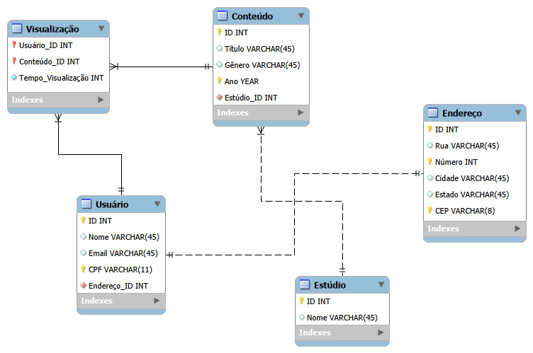

### Sistema relacional para gerenciamento de corridas nacionais de kart, incluindo controle de pilotos, equipes, etapas e patrocinadores.

📂 Projeto

* 🏎️ **[Gerenciamento de Kart](./banco-de-dados/criacao.sql)** *(arquivo do MySQL Workbench — visualize o diagrama abaixo)*

### Requisitos do Projeto:
- Criação completa do banco (DDL)
- Inserção de dados da temporada (DML)
- Atualizações de etapas (UPDATE)
- Remoção de patrocinadores (DELETE)

  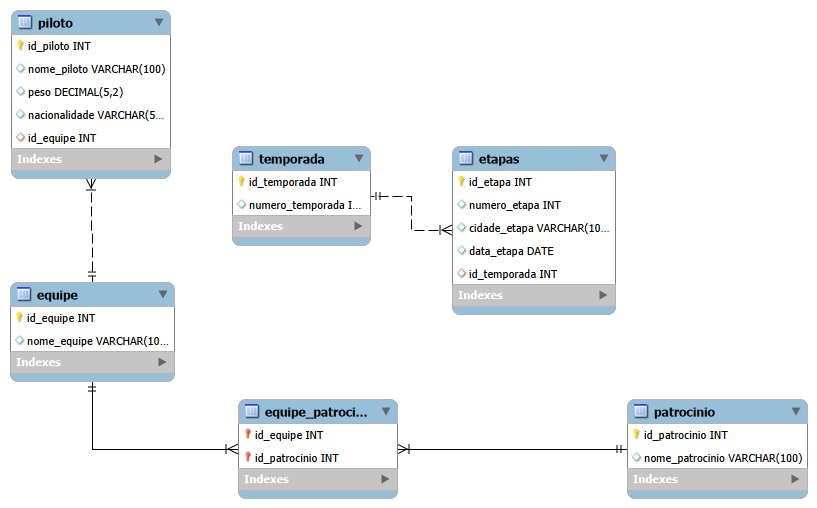

### Consultas complexas e filtros estruturados para plataforma de jogos.

📂 Projeto

* 🎮 **[Filtros Avançados TDS Cloud Gaming](./banco-de-dados/criacaofiltros-queries.sql)** 

**O Desafio:** Criar filtros de busca avançados para a plataforma TDS Cloud Gaming, aplicando técnicas avançadas de consulta em MySQL como agregações, JOINs e subconsultas.

### Requisitos do Projeto:
- Seleção de registros com filtros temporais e financeiros.
- Uso de funções de agregação para cálculos de média e totais.
- Implementação de junções entre múltiplas tabelas (Usuários, Bibliotecas e Jogos).
- Identificação de valores máximos e filtros por localização geográfica.

### 📊 Habilidades desenvolvidas:
- Modelagem de banco de dados relacional (DER)
- Criação de tabelas com chaves primárias e estrangeiras
- Estruturação de relacionamentos (1:N e N:N)
- Manipulação de dados com SQL (INSERT, UPDATE, DELETE)
- Desenvolvimento de consultas SQL (SELECT)
- Utilização de JOINs (INNER JOIN, LEFT JOIN)
- Aplicação de funções de agregação (AVG, SUM, MAX, COUNT)
- Construção de filtros avançados (WHERE, HAVING)
- Uso de subconsultas para análise de dados
- Análise de dados com base em regras de negócio
- Extração de métricas (preço médio, total de compras, contagem de registros)

---

## 🗄️ PROJETO INTEGRADOR - ASSISTENTE DE DESENVOLVIMENTO DE SISTEMAS:
### OperaSystem - Sistema de Gerenciamento de Assistência Técnica

### 📊 Status do Projeto

🏆 Concluído / Aprovado (Conceito D - Desenvolveu)

## 🎯 Objetivo do Software
O **OperaSystem** é uma aplicação desktop desenvolvida para otimizar e automatizar o fluxo de trabalho de uma assistência técnica. O sistema visa centralizar o controle de acessos, o cadastro de clientes e o registro de atendimentos, substituindo processos manuais por uma solução segura, rápida e integrada a um banco de dados relacional.

## ⚙️ Funcionalidades do Sistema (Requisitos)
* **Controle de Acesso (Login):** Autenticação segura de usuários cadastrados no banco de dados para proteção das informações do sistema.
* **Cadastro de Clientes:** Tela intuitiva para inserção, validação e persistência de dados de clientes (Nome, CPF/CNPJ, Telefone e E-mail) diretamente no banco de dados.
* **Navegação de Fluxo:** Transição fluida entre as telas de Login, Cadastro de Clientes e Registro de Atendimentos.
* **Persistência de Dados:** Integração completa para salvar, ler e estruturar informações em tempo real.

## 🛠️ Tecnologias Aplicadas
Considerando apenas as tecnologias abordadas ao longo deste módulo:
* **Java SE (Standard Edition):** Linguagem de programação principal utilizada no desenvolvimento do sistema.
* **Java Swing:** Framework utilizado para a criação e design das interfaces gráficas (GUI).
* **MySQL Database:** Banco de dados relacional utilizado para persistência dos dados.
* **JDBC (Java Database Connectivity):** API de conexão e o driver `mysql-connector-j` para comunicação entre a aplicação Java e o banco MySQL.

## 🎨 Interface e Protótipo (UX/UI)
O design visual e a experiência do usuário (UX/UI) foram planejados e estruturados no Figma antes da implementação do código, garantindo usabilidade e um fluxo intuitivo para o sistema.

📂 Projeto

* 🔗 **[Acessar Protótipo Interativo no Figma](https://www.figma.com/proto/TCXw1lDy9cpMJhPA3vOeSt/Projeto-Senac?node-id=42-7&t=CUuK3TVibQBDClna-0&scaling=scale-down&content-scaling=fixed&page-id=0%3A1&starting-point-node-id=42%3A7])**

* ⚙️ **[Projeto OperaSystem](./operasystem-interfaces)**

## 👥 Time de Desenvolvedores
* **Thays Estefhany Reis França** - Desenvolvedora do Sistema
  
---

## 🗄️ DISCIPLINA - AUXILIAR NA ADMINISTRAÇÃO DE BANCO DE DADOS:
Realização de testes de segurança e elaboração de um plano de backup em um banco de dados de teste, simulando uma versão simplificada do sistema final.

A atividade teve como objetivo aplicar procedimentos de exportação e backup de dados, além da criação e gerenciamento de usuários com diferentes níveis de permissão no banco de dados.

## Atividades realizadas

💾 **Exportação de dados**

- Exportação individual das tabelas do banco de dados;
- Exportação completa do banco de dados;
- Execução dos procedimentos de backup utilizando o MySQL Workbench;
- Registro das etapas por meio de capturas de tela.

🔐 **Gestão de usuários e permissões**

- Criação de usuário com permissões completas de CRUD (CREATE, READ, UPDATE e DELETE);
- Criação de usuário com permissão somente para consulta;
- Aplicação e teste das permissões de acesso.

📂 Projetos

📄 [Relatório - Backup e Segurança](./banco-de-dados/relatorio-backup-e-criacao-de-usuarios.pdf)

💻 [Script SQL](./banco-de-dados/script-criacao-insercao.sql)

---

## 🗄️ DISCIPLINA - DESENVOLVER PROJETO DE INTERFACE PARA MELHOR EXPERIÊNCIA DO USUÁRIO:

### Sistema Desktop - Pizzaria do Sr. Manoel (Protótipo UI/UX)

Protótipo de alta fidelidade desenvolvido no Figma para um sistema desktop 
de gestão de uma pizzaria, contemplando login, controle de caixa e 
cadastro de clientes.

## 🎯 Sobre o Projeto

Projeto desenvolvido como parte da disciplina de UI/UX com foco em criar uma navegação fluida 
entre telas e uma experiência de usuário agradável.

## 🖥️ Telas Desenvolvidas

- **Login** — tela de autenticação do sistema.
- **Tela de erro** — feedback visual de usuário/senha inválidos.
- **Controle de Caixa** — registro de entradas e saídas financeiras.
- **Cadastro de Clientes** — formulário de cadastro com dados de contato.

## 🎨 Protótipo Interativo

[Acesse o Protótipo Navegável no Figma](https://www.figma.com/proto/QjyoQaU6qb7vhImM8xqcKZ/Wireframes-Pizzaria?node-id=34-478&p=f&t=ybuqKkQgu0wA8tHJ-1&scaling=min-zoom&content-scaling=fixed&page-id=0%3A1)

## 📄 Todas as Telas do Wireframe

  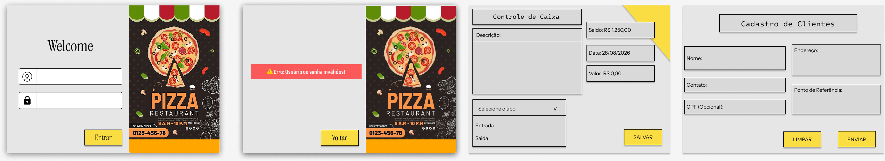

## 🛠️ Ferramentas Utilizadas

- Figma (prototipação e design UI/UX)

## 📌 Status

✅ Projeto entregue e avaliado — feedback: "Wireframes bem desenvolvidos 
e navegação válida."

---

## 🗄️ DISCIPLINA - DESENVOLVER E ORGANIZAR INTERFACE GRÁFICA PARA APLICAÇÕES DESKTOP 

### Projeto Loja MVP (Java)

## 📋 Enunciado

**Contexto:** uma empresa de desenvolvimento está montando um MVP (produto viável mínimo) para uma loja, e a tarefa era criar telas simples em Java, usando apenas código, sem ferramentas visuais.

**O que foi pedido:**
- Criar uma janela com um campo de texto e um botão, onde o usuário informa o valor de uma venda.
- Se o valor for maior que 500, abrir uma caixa de diálogo pedindo o percentual de desconto (apenas números).
- Calcular o valor total, com desconto quando houver, e mostrá-lo em outra caixa de diálogo.
- Validar os valores informados pelo usuário.

## 📸 Telas da Aplicação

<table>
  <tr>
    <th align="center">1. Entrada do valor da venda</th>
    <th align="center">2. Percentual de desconto</th>
    <th align="center">3. Valor total</th>
  </tr>
  <tr>
    <td align="center" valign="middle">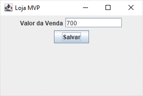</td>
    <td align="center" valign="middle">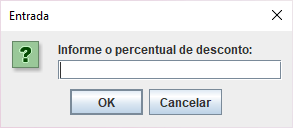</td>
    <td align="center" valign="middle">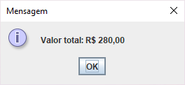</td>
  </tr>
</table>

## 🛠️ Ferramentas Utilizadas
- Java (Swing)
- NetBeans

## 📌 Status

Projeto entregue e avaliado pelo professor:

> "Boa entrega da atividade, todos os critérios atingidos. Parabéns!"

📂 Projeto

[Ver código do projeto](java/lojamvp-java/)

## 🥗 Projeto NutriSoft (Java)

Software desktop em Java (Swing) que reúne cálculos comuns da rotina de nutricionistas: IMC, gasto calórico e recomendação de nutrientes.

### 📋 Enunciado

**Contexto:** o Sindicato dos Nutricionistas quer distribuir aos associados um software desktop para realizar rapidamente cálculos comuns na rotina da profissão.

**O que foi pedido** (usando a ferramenta visual do NetBeans):
- Tela inicial com botões que levam às demais telas.
- **IMC:** calcula Peso / Altura² e mostra a interpretação (Magreza, Normal, Sobrepeso, Obesidade, Obesidade grave).
- **Gasto Calórico:** calcula o gasto basal (conforme o sexo) e o gasto total (conforme o nível de atividade física).
- **Recomendações:** a partir das calorias diárias, calcula em gramas os carboidratos (50%), proteínas (25%) e gordura (25%).
- Validações: o programa não pode quebrar com valores inválidos e deve pedir o preenchimento de todos os campos.

### 📸 Telas da Aplicação

<table>
  <tr>
    <th align="center" width="50%">Menu inicial</th>
    <th align="center" width="50%">Cálculo de IMC</th>
  </tr>
  <tr>
    <td align="center" valign="top">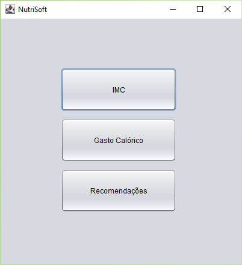</td>
    <td align="center" valign="top">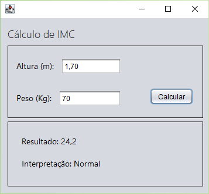</td>
  </tr>
  <tr>
    <th align="center">Gasto calórico</th>
    <th align="center">Recomendações</th>
  </tr>
  <tr>
    <td align="center" valign="top">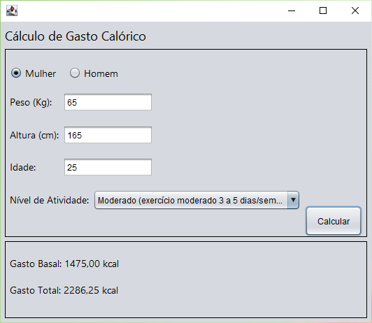</td>
    <td align="center" valign="top">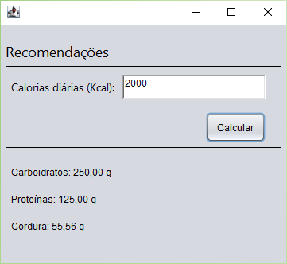</td>
  </tr>
  <tr>
    <th align="center" colspan="2">Validação de campos vazios</th>
  </tr>
  <tr>
    <td align="center" valign="top" colspan="2">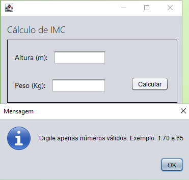</td>
  </tr>
</table>

## 🛠️ Ferramentas Utilizadas
- Java (Swing)
- NetBeans 

## 📌 Status

Projeto entregue e avaliado pelo professor:

> "Boa entrega da atividade, todos os critérios atingidos. Parabéns!"

📂 Projeto

[Ver código do projeto](java/nutrisoft-java/)

---

## 🗓️ Projeto AgendaNutri – Sistema de Agendamento de Consultas

Software desktop em Java (Swing) para consultórios de nutrição.

### 📋 Contexto
O Sindicato de Nutricionistas pediu uma prova de conceito de um sistema de agendamento para os consultórios associados. Nesta etapa, **não há banco de dados**: todas as operações acontecem em **listas em memória**.

### ✅ Funcionalidades
- Listagem de todas as consultas cadastradas em uma tabela (paciente, CPF, telefone, data, já era paciente?, consulta realizada)
- Cadastro de nova consulta
- Exclusão da consulta selecionada na tabela
- Finalização de consulta com receita e observações
- Atualização automática da tabela após inclusão, exclusão ou finalização

### 🖥️ Telas

<table>
  <tr>
    <th align="center" colspan="2">Tela inicial</th>
  </tr>
  <tr>
    <td align="center" valign="top" colspan="2">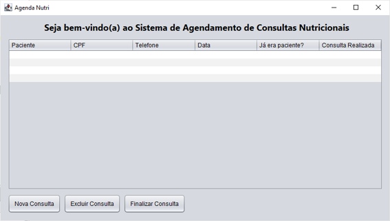</td>
  </tr>
  <tr>
    <th align="center">Cadastrar consulta</th>
    <th align="center">Detalhes da consulta</th>
  </tr>
  <tr>
    <td align="center" valign="top">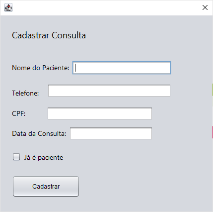</td>
    <td align="center" valign="top">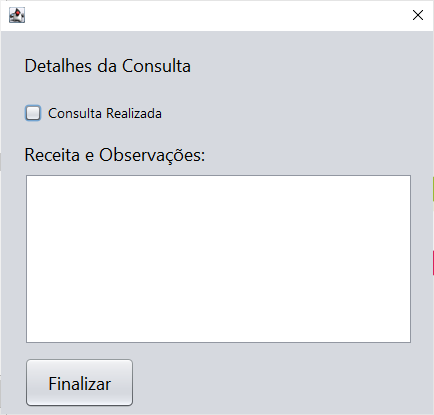</td>
  </tr>
  <tr>
    <th align="center" colspan="2">Tela inicial com consultas cadastradas</th>
  </tr>
  <tr>
    <td align="center" valign="top" colspan="2">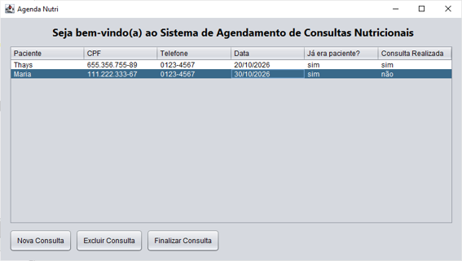</td>
  </tr>
</table>
### 🔒 Regras e validações
- Validação do formato de **CPF**, **data** e **telefone**
- Não permite cadastrar sem informar nome, CPF, telefone e data da consulta
- A checkbox *Consulta Realizada* é marcada automaticamente quando a consulta já foi finalizada e fica desabilitada para edição
- O botão *Finalizar* só aparece se a consulta ainda não foi realizada
- Não permite finalizar sem texto no campo de receita e observações
- Uso de **tratamento de exceções** para evitar que o programa quebre

### 🛠️ Ferramentas Utilizadas
- Java (Swing)
- NetBeans

### 💡 Aprendizados
- Comunicação entre telas (passando a consulta selecionada para a tela de detalhes)
- Manipulação de dados em memória com listas e `JTable`
- Validação de entrada e tratamento de exceções

### 📌 Status

Projeto entregue e avaliado pelo professor:

> "Boa entrega da atividade, todos os critérios atingidos. Parabéns!"

**Melhoria futura:** separar a validação da formatação. O ideal é validar apenas os dígitos (quantidade e regra do CPF, por exemplo) e aplicar a máscara (`.`, `-`, `/`) somente na exibição.

📂 Projeto

[Ver código do projeto](java/agendanutri-java/)
